# MANUAL DE USUARIO DE GITHUB
## Sistema de Gestión de Reservas — Hotel Andino

**Curso:** Herramientas de Desarrollo  
**Versión:** 1.0  
**Fecha:** 28 de noviembre de 2026  
**Repositorio:** https://github.com/Fiorellax1/sistema-reservas-hotel  
**Dirigido a:** integrantes del equipo, docentes y responsables de mantenimiento.

---

## 1. Objetivo

Explicar el uso del repositorio GitHub para consultar el código fuente, registrar tareas, trabajar mediante ramas, crear Pull Requests (PR), comprobar la integración continua (CI), verificar el despliegue continuo (CD) y conservar la trazabilidad de los cambios del Hotel Andino.

## 2. Requisitos

- Acceso a Internet y navegador actualizado.
- Cuenta GitHub para comentar, crear ramas o proponer modificaciones; permisos de escritura para subir cambios al repositorio del equipo.
- Git instalado para trabajar desde una computadora y Visual Studio Code como editor recomendado.
- Para probar el sistema completo localmente: Docker Desktop con el motor en funcionamiento y Docker Compose.

La consulta de un repositorio público no requiere permisos de escritura. Las acciones de edición y fusión dependen de los permisos que tenga cada integrante.

## 3. Acceso al repositorio

1. Abrir https://github.com/Fiorellax1/sistema-reservas-hotel.
2. Seleccionar la pestaña **Code** para revisar carpetas y archivos.
3. Utilizar el selector de ramas para elegir `main`, `develop` u otra rama.
4. Seleccionar **Commits** o el historial de un archivo para consultar sus modificaciones.

### 3.1 Organización principal

| Carpeta o archivo | Función |
|---|---|
| `frontend/` | Interfaz web de Hotel Andino: HTML, CSS y JavaScript. |
| `frontend/js/api.js` | Comunicación del navegador con los servicios HTTP. |
| `backend/src/` | Servidor Node.js/Express, conexión MySQL, rutas y middleware. |
| `backend/sql/schema.sql` | Estructura inicial de la base de datos MySQL. |
| `backend/Dockerfile` | Imagen del servicio backend. |
| `frontend/Dockerfile` y `frontend/nginx.conf` | Imagen y configuración Nginx del frontend. |
| `compose.yaml` | Orquestación local de frontend, backend y MySQL. |
| `.github/workflows/` | Automatizaciones de integración y despliegue. |
| `test/` | Pruebas automatizadas del módulo de reservas. |
| `scripts/` | Verificaciones auxiliares de estructura y trazabilidad. |
| `docs/` | Manuales y documentación para usuarios. |

Los archivos `.env` contienen configuración privada y **no deben subirse**. Los archivos `.env.example` sirven como plantillas sin credenciales reales.

## 4. Flujo de trabajo con Git y GitHub

El equipo utiliza el flujo:

`feature/*` → `develop` → `main`

- **`feature/*`:** desarrollo de una función, ajuste o corrección.
- **`develop`:** integración y revisión del trabajo de los integrantes.
- **`main`:** versión principal que recibe los cambios aprobados.

### 4.1 Clonar el repositorio

Abrir PowerShell en la carpeta deseada y ejecutar:

```powershell
git clone https://github.com/Fiorellax1/sistema-reservas-hotel.git
cd sistema-reservas-hotel
```

Para obtener las últimas modificaciones antes de empezar:

```powershell
git switch develop
git pull origin develop
```

Si Git informa cambios locales, se deben revisar antes de cambiar de rama o descargar actualizaciones.

### 4.2 Crear una rama de trabajo

```powershell
git switch -c feature/nombre-de-la-mejora
```

Realizar las modificaciones en VS Code; luego comprobar el estado:

```powershell
git status
git diff
```

### 4.3 Validar antes de guardar

Desde la raíz del repositorio:

```powershell
npm ci
npm run lint
npm test
```

Las pruebas unitarias documentadas para el módulo de reservas son 10. El resultado esperado, en el estado verificado del proyecto, es `pass 10` y `fail 0`.

`npm ci` reinstala dependencias según el archivo de bloqueo. El análisis estático mediante ESLint y las pruebas unitarias no sustituyen la revisión funcional del sistema con MySQL y Docker.

### 4.4 Crear commit y publicar rama

```powershell
git add .
git diff --cached --check
git commit -m "feat: describir el cambio realizado"
git push -u origin feature/nombre-de-la-mejora
```

**Antes de ejecutar `git add .`**, revisar que no se agreguen `.env`, contraseñas, archivos personales ni dependencias `node_modules`. Para inspeccionar los archivos preparados se puede ejecutar `git diff --cached --name-only`.

### 4.5 Crear un Pull Request

1. Abrir **Pull requests** en GitHub y pulsar **New pull request**; alternativamente usar **Compare & pull request**.
2. Elegir **base: `develop`** y **compare: `feature/nombre-de-la-mejora`**.
3. Escribir un título breve y explicar el objetivo, los archivos modificados y las pruebas realizadas.
4. Asociar el trabajo con un Issue real, por ejemplo `Refs #12` si el PR corresponde a la integración de frontend, backend y base de datos.
5. Seleccionar **Create pull request**.
6. Revisar los comentarios, los archivos cambiados y las comprobaciones automáticas.
7. Fusionar solo cuando las comprobaciones requeridas hayan pasado y el equipo haya revisado el trabajo. Después, para una publicación, crear un nuevo PR de `develop` a `main`.

**Diferencia importante:** `Refs #12` deja constancia de la relación; `Closes #12` puede cerrar automáticamente el Issue al fusionar en la rama predeterminada si corresponde. Usar el texto apropiado según el estado de la tarea.

## 5. Gestión de Issues

1. Ingresar a la pestaña **Issues**.
2. Revisar las tareas abiertas y evitar crear duplicados.
3. Seleccionar un Issue relacionado con la actividad, o pulsar **New issue**.
4. Describir el requisito, resultado esperado, prioridad, responsable y criterios de aceptación cuando corresponda.
5. Vincular el Issue desde la descripción del Pull Request.
6. Cerrar el Issue cuando su trabajo esté efectivamente concluido y verificado.

**Ejemplo real:** Issue **#12 — Integrar frontend, backend y base de datos**, relacionado con el PR **#15**, fusionado en `develop`; posteriormente el PR **#16** incorporó el trabajo de `develop` en `main`.

## 6. Revisión de GitHub Actions

Abrir la pestaña **Actions**. La marca verde indica una ejecución correcta y la marca roja representa una ejecución que falló. Cada ejecución se conserva en el historial, aunque otra ejecución posterior haya corregido el problema.

| Workflow | Finalidad |
|---|---|
| **CI 1 — Validación de HTML** | Verificar la estructura y reglas del HTML. |
| **CI 2 — Análisis estático de JavaScript** | Detectar problemas de estilo o código mediante ESLint. |
| **CI 3 — Pruebas unitarias de reservas** | Ejecutar las pruebas automatizadas del módulo de reservas. |
| **CI 4 — Estructura y trazabilidad** | Verificar archivos del proyecto y referencias a Issues en los PR. |
| **CD — Despliegue en GitHub Pages** | Publicar el frontend estático según la configuración de la rama principal. |

### 6.1 Consultar un error

1. Abrir una ejecución marcada en rojo.
2. Seleccionar el trabajo con error en el panel lateral.
3. Expandir el paso que falló.
4. Leer el mensaje, identificar el archivo y línea, y aplicar la corrección en una rama.
5. Crear un nuevo commit y comprobar la ejecución nueva; no es necesario borrar las ejecuciones fallidas anteriores.

### 6.2 Evidencias del proyecto

- **PR #15:** integración del backend, MySQL y Docker a `develop`.
- **PR #16:** integración de `develop` en `main`.
- **CI 2:** fallo inicial por variable JavaScript no utilizada y comprobaciones posteriores correctas.
- **CI 4:** fallo por referencia ausente a un Issue, posteriormente corregido; ejecución **#12** correcta en `main` después del ajuste YAML.
- **CD GitHub Pages:** ejecución **#3** correcta en `main` después de corregir la configuración.

Estas ejecuciones constituyen evidencia del proceso de identificación, corrección y validación continua de cambios.

## 7. Publicación y diferencias entre GitHub Pages y Docker

**GitHub Pages** publica los recursos estáticos del frontend. No ejecuta Node.js, Express ni el servidor MySQL del proyecto. Por tanto, no debe presentarse la versión de GitHub Pages como demostración de toda la arquitectura con base de datos.

**Docker Compose** permite ejecutar localmente los tres servicios del sistema completo. Desde la carpeta que contiene `compose.yaml`, una vez configuradas las variables privadas conforme a los ejemplos del repositorio:

```powershell
docker compose up --build -d
docker compose ps
```

Acceder a **http://localhost:8080**. Para detener los contenedores conservando el volumen de datos:

```powershell
docker compose down
```

**No usar `docker compose down -v`** si se desea conservar los datos MySQL: `-v` elimina también los volúmenes de Compose. El esquema SQL se utiliza para inicializar una base de datos nueva; no reimporta automáticamente el historial real de otra instalación.

## 8. Recomendaciones de seguridad

- Nunca subir contraseñas, tokens JWT ni el contenido real de `.env`.
- Mantener `.env.example` sin datos secretos y verificar `.gitignore`.
- Revisar permisos de escritura, cambios del PR y resultados de CI antes de fusionar.
- Usar contraseñas seguras para usuarios, MySQL y secretos JWT.
- No usar la aplicación de desarrollo local como servicio público de producción sin configuración adicional de HTTPS, acceso de red, copias de seguridad y controles de seguridad.

## 9. Solución de problemas frecuentes

| Situación | Acción recomendada |
|---|---|
| Git muestra `not a git repository` | Abrir la carpeta clonada que contiene `.git`. |
| `eslint` no se reconoce | Ejecutar `npm ci` desde la raíz del repositorio. |
| CI 2 marca una variable no utilizada | Revisar el archivo y la línea señalados por ESLint. |
| CI 4 indica falta de Issue | Agregar `Refs #N` con el número de una tarea real al cuerpo del PR. |
| CI 4 indica error YAML | Revisar la indentación y evitar claves duplicadas, especialmente `branches`. |
| GitHub muestra ejecuciones históricas en rojo | Revisar la ejecución más reciente y su commit; no asumir que un error antiguo sigue presente. |
| El frontend de GitHub Pages no encuentra la API local | Usar la demostración completa en Docker (`localhost:8080`). |

## 10. Evidencias fotográficas para el informe


## Evidencias del uso de GitHub

Las siguientes capturas muestran la gestión del repositorio, la trazabilidad de tareas, la integración de cambios y la ejecución de los procesos de integración y despliegue continuo del Sistema de Gestión de Reservas Hotel Andino.

### Figura M-G1. Repositorio principal del Hotel Andino

La siguiente imagen muestra el repositorio principal del proyecto en GitHub, con la rama `main` seleccionada y los archivos que conforman el sistema.

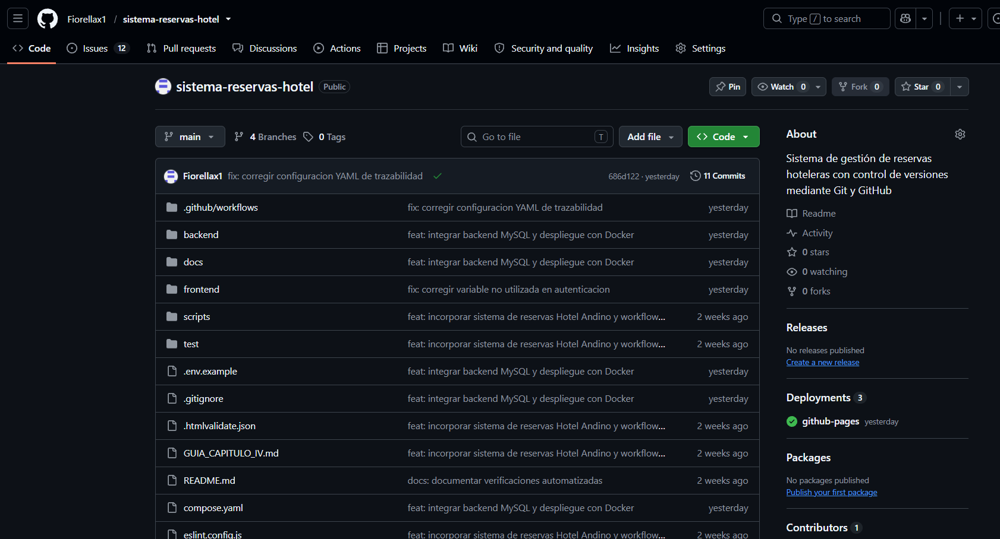

*Figura M-G1. Repositorio principal del Hotel Andino en GitHub, rama `main`.*

### Figura M-G2. Lista de Issues y trazabilidad de tareas

La siguiente captura muestra los Issues utilizados para organizar y dar seguimiento a las actividades de desarrollo del proyecto.

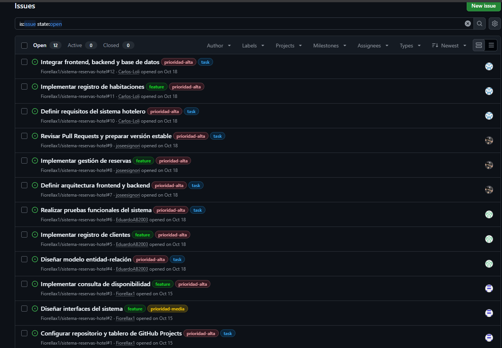

*Figura M-G2. Lista de Issues y trazabilidad de tareas del Hotel Andino.*

### Figura M-G3. Pull Request #15 fusionado a develop

La imagen evidencia la integración de la rama `feature/integracion-backend-docker` en `develop`, mediante el Pull Request #15.

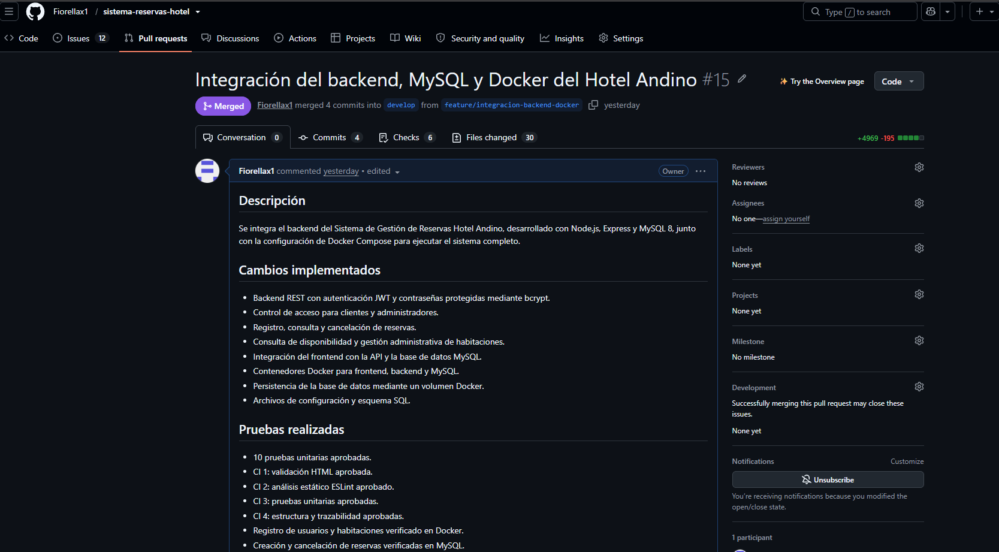

*Figura M-G3. Pull Request #15 fusionado correctamente a la rama `develop`.*

### Figura M-G4. Pull Request #16 fusionado a main

La siguiente captura evidencia la integración de los cambios de `develop` en `main`, mediante el Pull Request #16.

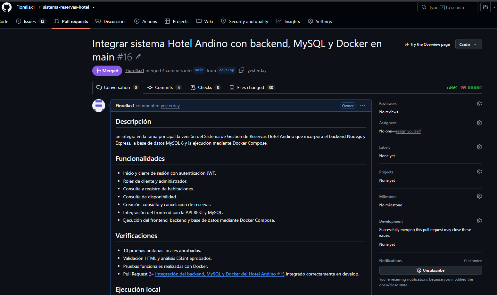

*Figura M-G4. Pull Request #16 fusionado correctamente a la rama `main`.*

### Figura M-G5. Workflows CI aprobados en GitHub Actions

Las siguientes cuatro capturas evidencian las verificaciones automáticas ejecutadas mediante GitHub Actions.

**CI 1 — Validación de HTML**

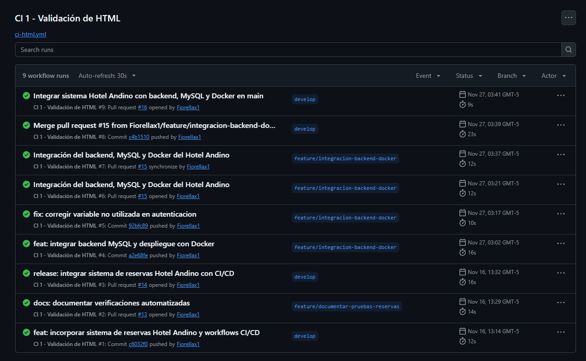

*Figura M-G5a. Ejecución aprobada del workflow CI 1: Validación de HTML.*

**CI 2 — Análisis estático de JavaScript**

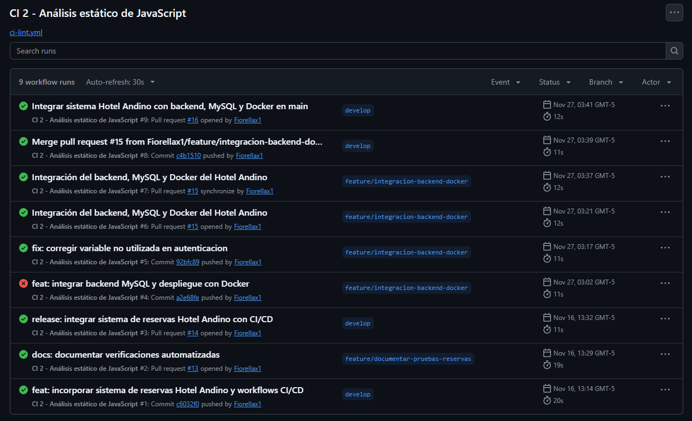

*Figura M-G5b. Ejecución aprobada del workflow CI 2: Análisis estático con ESLint.*

**CI 3 — Pruebas unitarias de reservas**

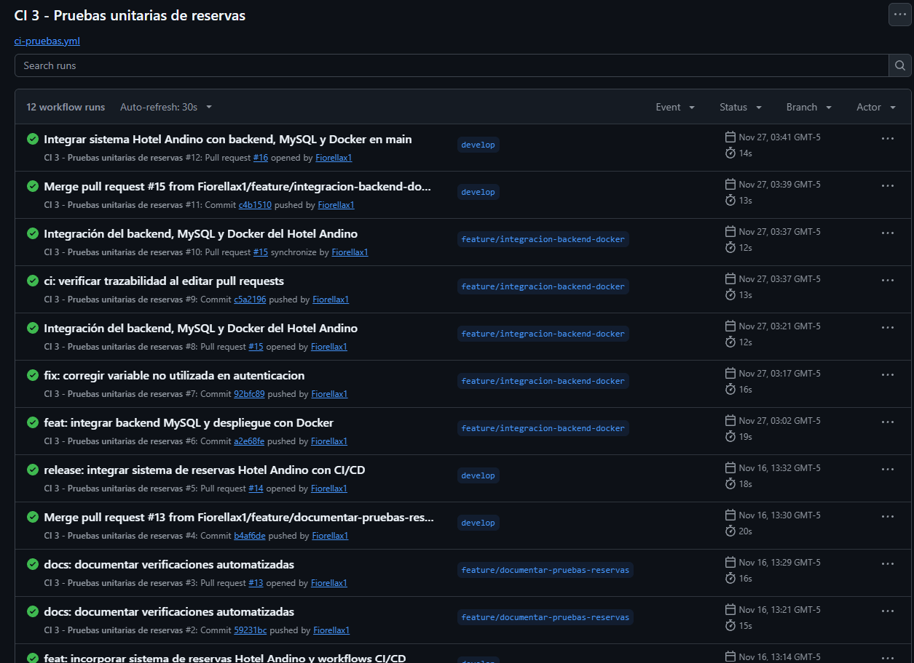

*Figura M-G5c. Ejecución aprobada del workflow CI 3: Pruebas unitarias de reservas.*

**CI 4 — Estructura y trazabilidad**

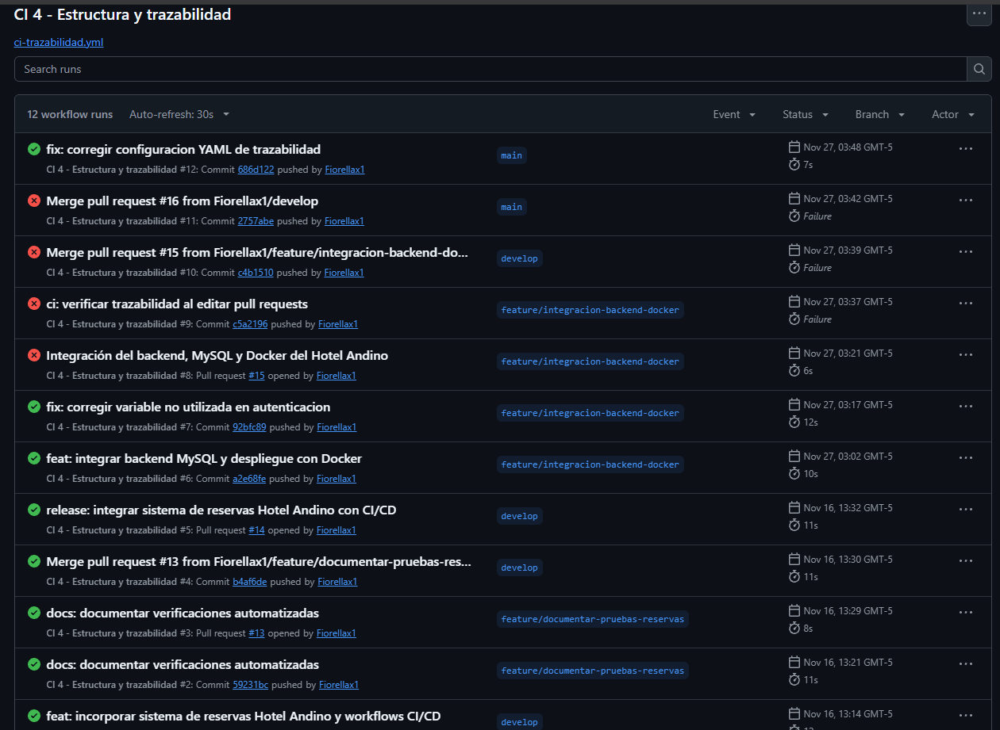

*Figura M-G5d. Ejecución aprobada del workflow CI 4: Estructura y trazabilidad.*

### Figura M-G6. Despliegue continuo en GitHub Pages

La siguiente captura evidencia la ejecución correcta del workflow de despliegue continuo (CD), que publica los archivos estáticos del frontend en GitHub Pages.

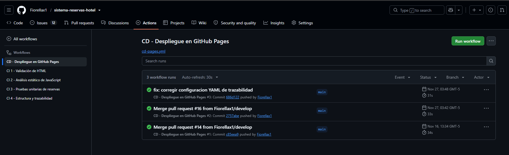
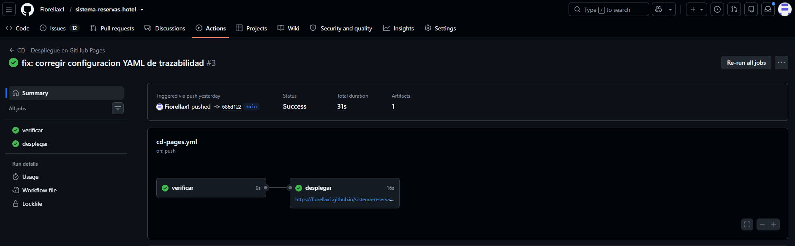
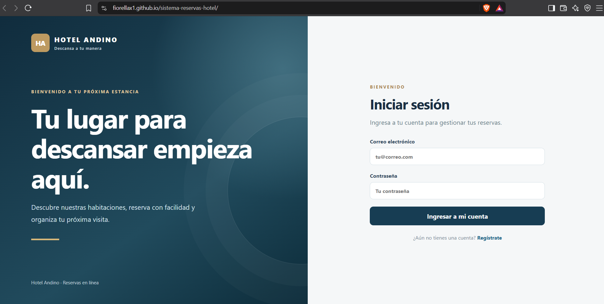

*Figura M-G6. Ejecución correcta del despliegue CD en GitHub Pages.*

**Nota:** GitHub Pages aloja el frontend estático. El sistema completo, integrado con el backend Node.js, Express y MySQL, se ejecuta localmente mediante Docker Compose.


---

**Fin del Manual de Usuario de GitHub — Hotel Andino.**
