# MANUAL DE USUARIO DEL SISTEMA HOTEL ANDINO
## Sistema de Gestión de Reservas Hoteleras

**Curso:** Herramientas de Desarrollo  
**Versión:** 1.0  
**Fecha:** 28 de noviembre de 2026  
**Dirigido a:** clientes, administradores del hotel y personal responsable de la demostración académica.

---

## 1. Presentación

Hotel Andino es una aplicación web para consultar habitaciones, revisar su disponibilidad, crear reservas y cancelarlas. Incluye autenticación mediante correo y contraseña y funciones diferenciadas según el rol: **cliente** o **administrador**.

El sistema está compuesto por una interfaz web, una API de Node.js/Express y una base de datos MySQL. Para la demostración completa se ejecuta mediante Docker Compose.

## 2. Acceso al sistema

### 2.1 Requisitos de uso

- Computadora con navegador web actualizado.
- Aplicación y sus servicios en funcionamiento.
- Cuenta registrada para ingresar al sistema.

**Dirección de la demostración local:** http://localhost:8080

Esta dirección funciona desde la computadora donde se publican los puertos de Docker; no es un sitio público accesible desde cualquier lugar.

### 2.2 Iniciar el sistema completo (personal de demostración)

1. Abrir **Docker Desktop** y verificar que indique **Engine running**.
2. Abrir VS Code o PowerShell en la carpeta raíz que contiene `compose.yaml`.
3. Configurar los archivos de variables de entorno locales a partir de `.env.example` y `backend/.env.example`, sin publicar sus secretos.
4. Ejecutar:

```powershell
docker compose up --build -d
```

5. Comprobar los servicios:

```powershell
docker compose ps
```

6. Abrir **http://localhost:8080**.

Los servicios principales son `frontend`, `backend` y `mysql`. Para verificar su comunicación pueden abrirse las rutas **http://localhost:8080/api/health** y **http://localhost:8080/api/db-check**. En la segunda, el resultado esperado muestra la conexión MySQL y tres tablas del esquema.

**Atención:** la primera inicialización de un volumen vacío crea el esquema de las tablas. Los usuarios y reservas de prueba creados en otra instalación no aparecen automáticamente en una base nueva.

## 3. Usuarios y permisos

| Función | Cliente | Administrador |
|---|---:|---:|
| Iniciar sesión y cerrar sesión | Sí | Sí |
| Ver habitaciones y precios | Sí | Sí |
| Consultar disponibilidad | Sí | Sí |
| Registrar una reserva propia | Sí | Sí, mediante las funciones disponibles de reserva |
| Consultar sus reservas | Sí | Sí |
| Cancelar sus propias reservas | Sí | Sí |
| Acceder al panel Administración | No | Sí |
| Registrar habitaciones | No | Sí |
| Consultar usuarios registrados | No | Sí |
| Consultar todas las reservas | No | Sí |
| Cancelar reservas desde el panel administrativo | No | Sí |

El rol de administrador se asigna mediante un procedimiento autorizado del sistema; **registrarse como nuevo usuario no otorga permisos administrativos**. La interfaz oculta el panel de administración al cliente y el servidor verifica los permisos mediante JWT.

## 4. Crear una cuenta

1. Abrir **http://localhost:8080**.
2. En la pantalla **Iniciar sesión**, seleccionar **Regístrate**.
3. Completar los datos solicitados por el formulario, como nombre, correo electrónico y contraseña.
4. Enviar el formulario de registro.
5. Si el registro se realiza correctamente, ingresar o continuar a la aplicación según la pantalla mostrada.

Usar un correo no registrado previamente. Si el sistema indica que ya existe una cuenta con ese correo, iniciar sesión con esa cuenta en lugar de registrarla de nuevo.

## 5. Iniciar y cerrar sesión

### 5.1 Inicio de sesión

1. En la pantalla **Iniciar sesión**, escribir el correo electrónico registrado.
2. Introducir la contraseña correspondiente.
3. Hacer clic en **Ingresar a mi cuenta**.
4. Verificar que aparezca la pantalla principal con el saludo al usuario.

Si el correo o la contraseña no coinciden con una cuenta válida, el sistema no permitirá el acceso. Si la sesión expira, será necesario ingresar nuevamente.

### 5.2 Cierre de sesión

1. Ubicar el botón **Cerrar sesión** en la esquina superior derecha.
2. Pulsarlo.
3. Verificar que se muestre nuevamente la pantalla **Iniciar sesión**.

Por seguridad, cerrar la sesión después de usar una computadora compartida.

## 6. Pantalla de inicio

Una vez autenticado, se muestra la página de bienvenida del hotel y el menú de navegación. Entre las opciones del cliente se encuentran **Inicio**, **Habitaciones**, **Reservar** y **Mis reservas**. Para el administrador también aparece **Administración**.

La sección de inicio incluye un acceso a **Reservar una habitación** y puede mostrar indicadores de habitaciones y reservas.

## 7. Consultar habitaciones

1. Seleccionar **Habitaciones** en el menú principal.
2. Revisar las tarjetas del catálogo.
3. Consultar el número de habitación, tipo, capacidad máxima y precio por noche expresado en soles (S/).
4. Pulsar **Reservar** en la habitación deseada para continuar con la reserva.

**Ejemplos verificados en la demostración:** habitación **101 — Individual**, **102 — Doble**, **201 — Suite**, **303 — Doble** y **404 — Doble**. El catálogo visible depende de los registros de la base de datos activa.

## 8. Registrar una reserva

1. Iniciar sesión como cliente.
2. Seleccionar **Reservar** o el botón **Reservar** en una tarjeta de habitación.
3. Elegir la habitación y las fechas de entrada y salida mediante el formulario.
4. Verificar que la fecha de salida sea posterior a la de entrada.
5. Confirmar la operación en el formulario.
6. Si las fechas y la habitación son válidas, el sistema presenta el mensaje **«Reserva registrada correctamente»** y permite consultar el resultado en **Mis reservas**.

### 8.1 Reglas de disponibilidad

- La fecha de salida debe ser posterior a la de entrada.
- Una habitación en mantenimiento no se ofrece como disponible.
- No se permite confirmar dos reservas de la misma habitación con periodos superpuestos.
- Las reservas canceladas no impiden una reserva posterior para esas fechas.
- Las fechas de estancias consecutivas pueden ser válidas cuando la nueva entrada coincide con la salida de la reserva anterior.

**Ejemplo real de la demostración en Docker:** reserva de la habitación **102** del **15 al 18 de diciembre de 2026**, registrada correctamente y observada en MySQL.

## 9. Consultar «Mis reservas»

1. Iniciar sesión.
2. Seleccionar **Mis reservas**.
3. Revisar el historial asociado a la cuenta activa.
4. Cada registro muestra la habitación, fechas y estado de la reserva.

Los estados principales son:

| Estado | Significado |
|---|---|
| **Confirmada** | Reserva registrada y vigente en el sistema. |
| **Cancelada** | Reserva anulada; se conserva en el historial para consulta. |

Si el usuario aún no tiene reservas, la interfaz muestra un mensaje informativo en lugar del listado.

## 10. Cancelar una reserva como cliente

1. Abrir **Mis reservas**.
2. Ubicar una reserva en estado **Confirmada**.
3. Pulsar **Cancelar reserva**.
4. Confirmar la operación si la interfaz lo solicita.
5. Comprobar que aparece el mensaje **«Reserva cancelada correctamente»** y que el estado cambia a **Cancelada**.

Las reservas canceladas permanecen visibles como historial, pero no presentan un botón de cancelación activo. El servidor limita la cancelación a la persona propietaria o a un administrador autorizado.

**Ejemplo verificado:** la reserva de la habitación **102**, del **15 al 18 de diciembre de 2026**, cambió de **confirmada** a **cancelada**, y se comprobó el mismo estado en MySQL.

## 11. Panel de administración

### 11.1 Acceder

1. Iniciar sesión con una cuenta cuyo rol sea **administrador**.
2. Seleccionar **Administración** en el menú superior.
3. Revisar las secciones del panel: registro de habitaciones, habitaciones registradas, usuarios registrados y todas las reservas.

Un usuario cliente no debe tener acceso a los servicios administrativos aunque intente solicitar las rutas directamente.

### 11.2 Registrar una habitación

1. En **Administración**, localizar **Registrar habitación**.
2. Escribir el **Número** de la habitación, sin repetir uno existente.
3. Seleccionar el **Tipo**.
4. Indicar la **Capacidad** (número entero positivo).
5. Introducir el **Precio por noche (S/)**, mayor o igual a cero.
6. Pulsar **Guardar habitación**.
7. Comprobar el mensaje **«Habitación registrada correctamente»**.
8. Revisar su aparición en **Habitaciones registradas** y en el catálogo.

**Ejemplo verificado en la demostración Docker:** habitación **404**, tipo Doble, capacidad 2 y precio **S/ 280.00**. Fue visible tanto en la interfaz como en la consulta MySQL.

### 11.3 Consultar habitaciones registradas

En el mismo panel, desplazarse hasta la tabla **Habitaciones registradas**. Allí se muestran las habitaciones del sistema, incluyendo número, tipo, capacidad y precio por noche.

### 11.4 Consultar usuarios registrados

Desplazarse hasta **Usuarios registrados**. La tabla permite revisar **nombre, correo y rol** de las cuentas existentes. Esta visualización es una función administrativa; no debe utilizarse para difundir datos personales fuera del proyecto.

### 11.5 Consultar y cancelar reservas

1. Desplazarse hasta **Todas las reservas**.
2. Revisar las columnas **Cliente**, **Habitación**, **Entrada**, **Salida**, **Estado** y **Acción**.
3. Identificar una reserva **Confirmada**.
4. Utilizar **Cancelar** cuando corresponda y comprobar el cambio de estado.
5. Las reservas previamente canceladas muestran la acción deshabilitada.

**Ejemplo verificado:** el panel mostró la reserva de un cliente en la habitación 102; tras cancelarla, el estado se actualizó a **Cancelada** y coincidió con la tabla de MySQL.

## 12. Persistencia de los datos

Las cuentas, habitaciones y reservas se almacenan en MySQL, no únicamente en el almacenamiento del navegador. Docker Compose utiliza un volumen para conservar la información cuando se detienen y recrean los contenedores normales.

Para detener el sistema sin borrar el volumen:

```powershell
docker compose down
```

Para volver a iniciar:

```powershell
docker compose up -d
```

**Advertencia:** evitar `docker compose down -v` porque elimina los volúmenes y puede borrar los datos de la instalación Docker.

## 13. Mensajes y solución de problemas

| Situación | Explicación y acción |
|---|---|
| El sitio no abre en `localhost:8080` | Abrir Docker Desktop, comprobar el motor y ejecutar `docker compose ps`. |
| El sistema no conecta con MySQL | Revisar los contenedores y consultar `/api/db-check`; comprobar la configuración local de variables de entorno. |
| «Debes iniciar sesión» | Entrar nuevamente con una cuenta válida. |
| Credenciales incorrectas | Revisar correo y contraseña sin compartirlos con terceros. |
| El correo ya está registrado | Iniciar sesión o utilizar otro correo válido para el registro. |
| La habitación no está disponible | Elegir otro periodo o habitación. |
| Fechas incorrectas | Elegir una salida posterior a la entrada. |
| No se puede cancelar la reserva | Verificar que esté confirmada y que pertenezca a la cuenta o se utilice un administrador autorizado. |
| No aparece Administración | Verificar que el usuario realmente posea el rol administrador. |
| Faltan datos después de iniciar Docker | Verificar que se esté utilizando el mismo volumen y no una base de datos nueva. |

## 14. Seguridad y uso responsable

- No compartir contraseñas ni datos de acceso.
- No publicar capturas que revelen contraseñas, tokens, secretos JWT o archivos `.env`.
- Cerrar sesión al terminar.
- No cambiar directamente el rol de una cuenta desde la interfaz del navegador.
- La demostración está prevista para un entorno local de desarrollo; para un uso real en Internet se requerirían ajustes de seguridad, HTTPS, copias de seguridad y alojamiento apropiado.

## 15. Evidencias sugeridas para el informe final

Las siguientes capturas documentan las principales funciones del Sistema de Gestión de Reservas Hotel Andino, tanto para clientes como para administradores. También muestran la ejecución del sistema mediante Docker y la verificación de los datos almacenados en MySQL.

### Figura M-H1. Pantalla de inicio de sesión

El sistema presenta un formulario de autenticación en el que los usuarios ingresan su correo electrónico y contraseña para acceder a las funcionalidades correspondientes a su cuenta.

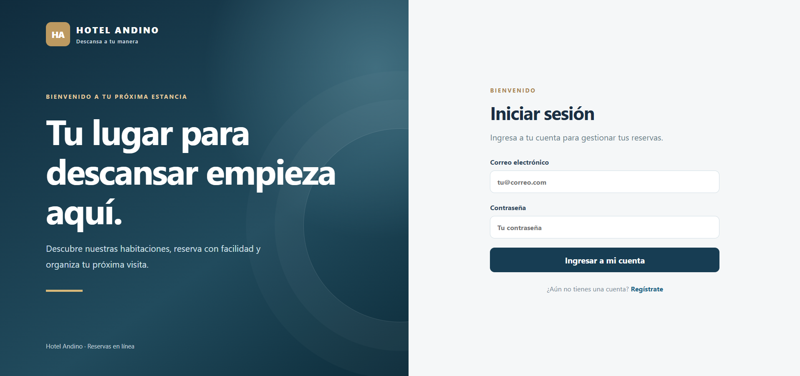

*Figura M-H1. Pantalla de inicio de sesión del Hotel Andino.*

### Figura M-H2. Inicio del usuario cliente

Después de iniciar sesión, el cliente accede a la pantalla principal, desde la cual puede consultar habitaciones, realizar reservas y revisar su historial.


*Figura M-H2. Pantalla de inicio del usuario cliente.*

### Figura M-H3. Catálogo de habitaciones y precios

La sección de habitaciones presenta las opciones registradas en el sistema, indicando su número, tipo, capacidad y precio por noche.

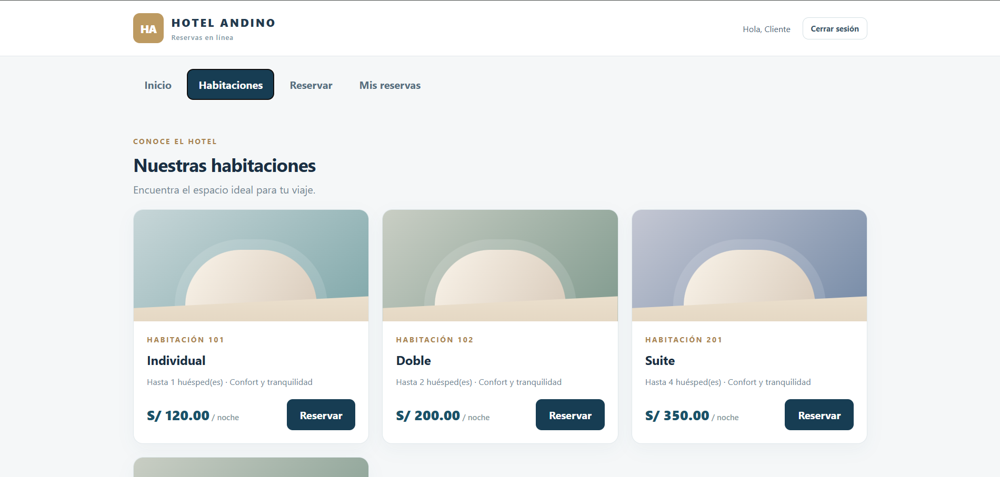


*Figura M-H3. Catálogo de habitaciones y precios del Hotel Andino.*

### Figura M-H4. Confirmación de una reserva

El cliente selecciona una habitación, indica las fechas de entrada y salida y confirma la operación. El sistema muestra un mensaje cuando la reserva se registra correctamente.

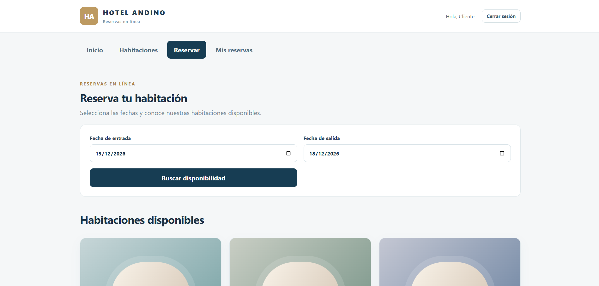
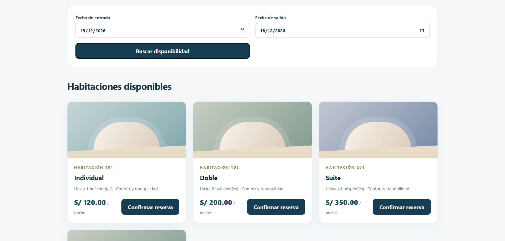
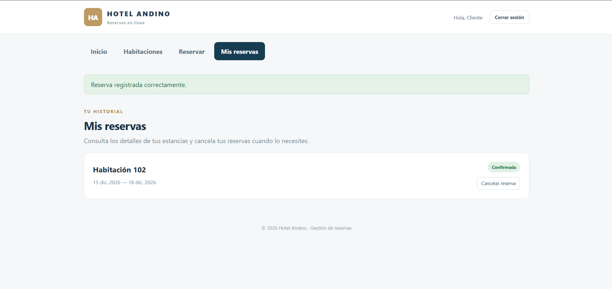

*Figura M-H4. Confirmación de una reserva registrada correctamente.*

### Figura M-H5. Historial de reservas y cancelación

En la sección "Mis reservas", el usuario puede consultar sus reservas y cancelar aquellas que se encuentran confirmadas. Después de cancelar, la reserva aparece con el estado "Cancelada".


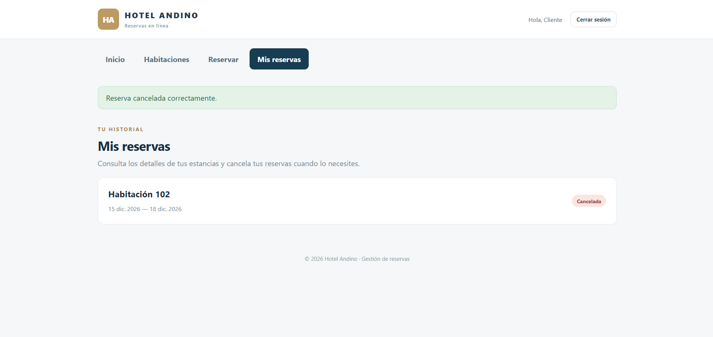

*Figura M-H5. Historial de reservas del cliente y visualización de una reserva cancelada.*

### Figura M-H6. Panel de administración

Los usuarios con rol de administrador pueden acceder al panel de gestión interna del hotel, donde se presentan las funciones administrativas del sistema.

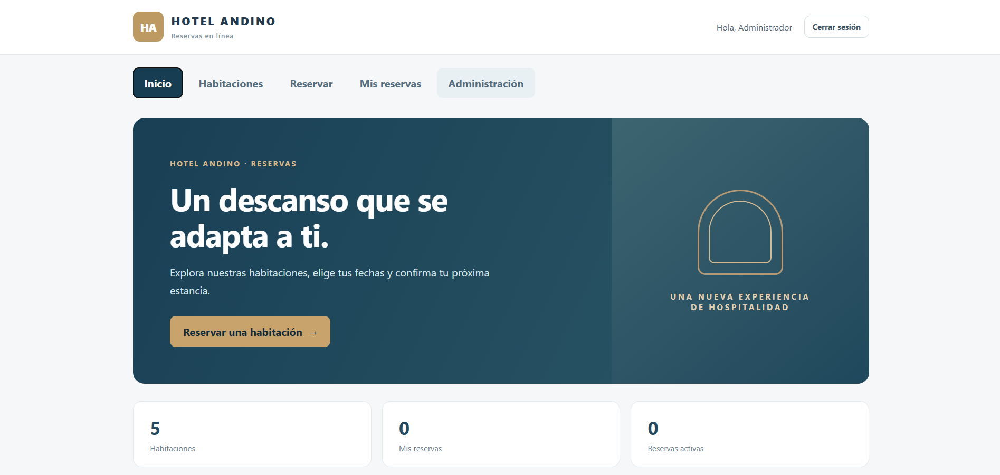

*Figura M-H6. Panel de administración del Hotel Andino.*

### Figura M-H7. Registro administrativo de habitación

El administrador puede registrar habitaciones ingresando su número, tipo, capacidad y precio por noche. Una vez guardada la información, la habitación aparece en el listado correspondiente.

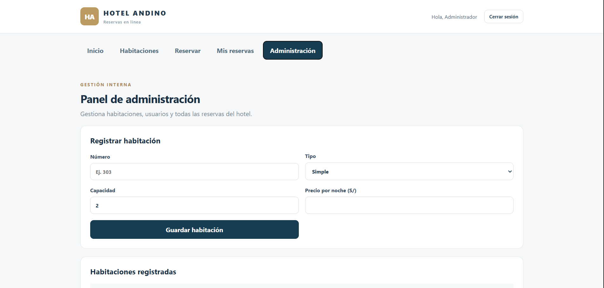
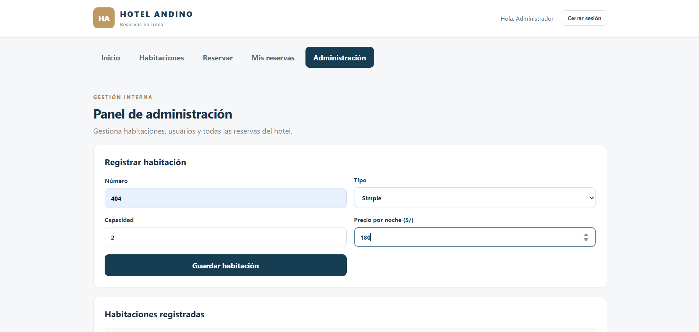
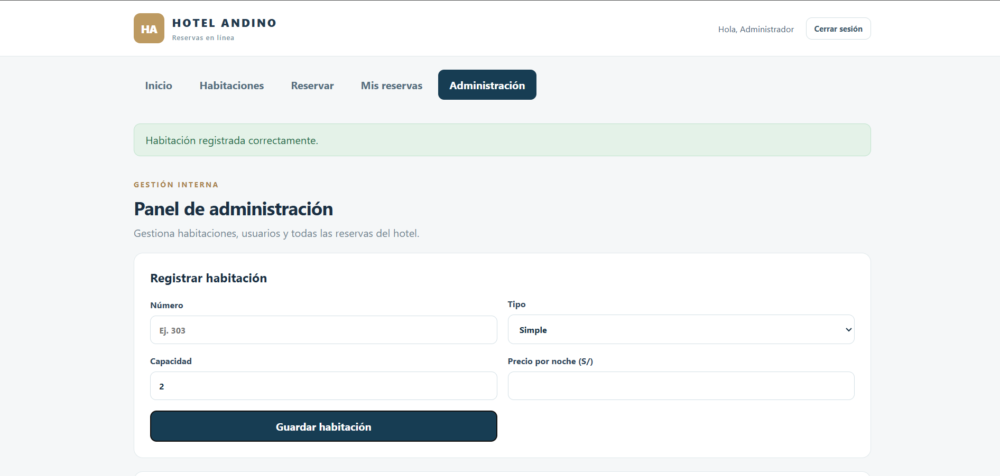
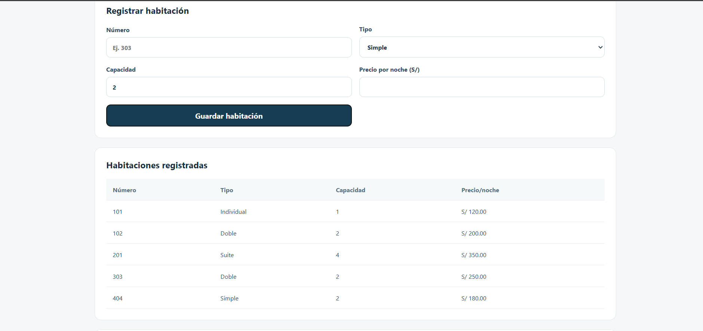

*Figura M-H7. Registro administrativo de una nueva habitación.*

### Figura M-H8. Tabla de usuarios registrados

El panel administrativo permite consultar los usuarios registrados en el sistema, mostrando su nombre, correo electrónico y rol asignado.

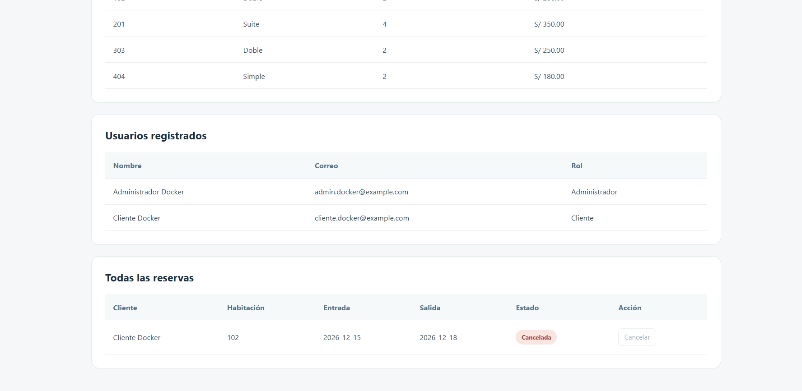

*Figura M-H8. Tabla de usuarios registrados en el Hotel Andino.*

### Figura M-H9. Tabla de todas las reservas

El administrador puede consultar las reservas del hotel, incluyendo el cliente, la habitación, las fechas de entrada y salida y el estado de cada reserva.

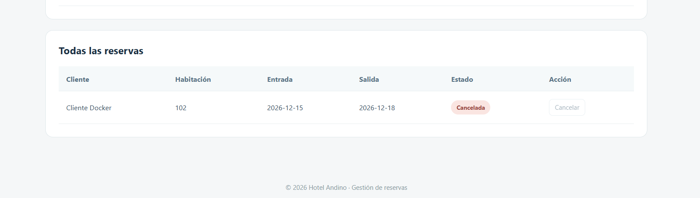

*Figura M-H9. Tabla de todas las reservas del Hotel Andino.*

### Figura M-H10. Docker Desktop con los contenedores activos

El sistema utiliza Docker Compose para ejecutar tres servicios: frontend, backend y base de datos MySQL. La siguiente captura evidencia la ejecución de los contenedores en Docker Desktop.

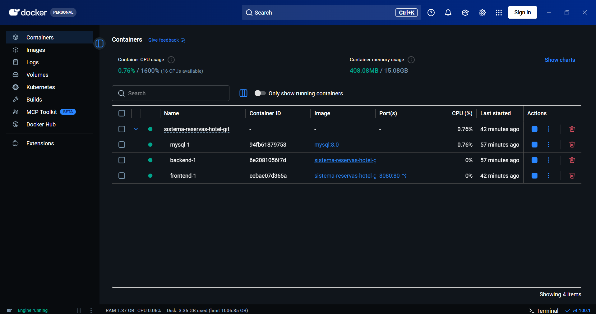

*Figura M-H10. Docker Desktop con los contenedores de frontend, backend y MySQL activos.*

### Figura M-H11. Verificación de datos en MySQL

La consulta realizada sobre la base de datos del sistema permite verificar que la información registrada mediante la aplicación se almacena en MySQL.

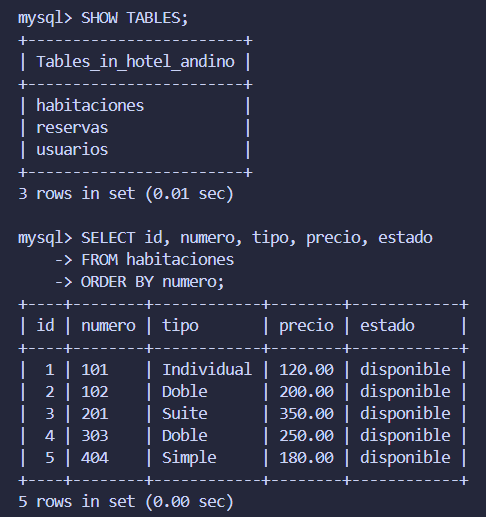
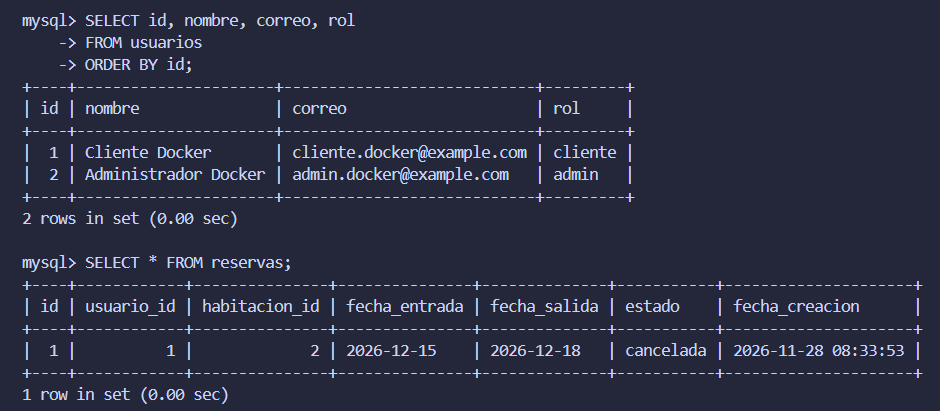

*Figura M-H11. Verificación de datos registrados en la base de datos MySQL del Hotel Andino.*


**Nota:** los ejemplos del manual provienen de las pruebas y pantallas realizadas para el proyecto. No representan credenciales de acceso ni garantizan que los mismos datos existan en una instalación nueva.

---

**Fin del Manual de Usuario del Sistema Hotel Andino.**
